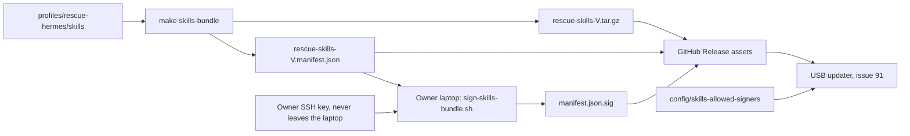

# Signed skills bundle: publishing and key custody

> Managed by **ahlikoding.com** and **satpamsiber.com** from **ahliweb.com**.

Ringkasan (ID): skill Hermes di USB yang sudah di lapangan hanya bisa diperbarui lewat bundel yang **ditandatangani manual oleh pemilik** dengan kunci SSH miliknya. CI hanya membangun dan memeriksa format bundel; CI tidak pernah menandatangani dan tidak pernah memegang kunci. USB memverifikasi tanda tangan terhadap `config/skills-allowed-signers` yang terpin. Selama berkas itu masih placeholder, tidak ada bundel yang dipercaya (fail closed). Sisi klien (pembaru saat Hermes start) ada di `ahliweb/linux-mint-xfce-rescue-ai#91`; dokumen ini hanya sisi penerbitan. Perintah, ID, dan path dipertahankan apa adanya.

Decision of the owner (2026-11-26): bundles are signed with the owner's own SSH key, manually, at release time (`ssh-keygen -Y sign`, namespace `rescue-skills`); the USB verifies with `ssh-keygen -Y verify` against a pinned `allowed_signers`; CI never signs.



The flow: CI builds only the unsigned pair; the owner signs the manifest locally; three assets go to the release; the USB checks them against the pinned public key.

## Status

| Part | Status |
|---|---|
| `make skills-bundle`, deterministic tarball and manifest, strict format check (`scripts/build-skills-bundle.py`, `scripts/lib/skills_bundle.py`) | Implemented |
| `scripts/sign-skills-bundle.sh` (owner only, refuses in CI) | Implemented; a real owner signature is an owner action |
| CI: build twice, byte-identical, format check; never signs (`.github/workflows/ci.yml`) | Implemented |
| `config/skills-allowed-signers` | Placeholder until the owner supplies the public key |
| Client updater | Planned, see #91 |

## Format

Three release assets per bundle version `V` (`V` is the content of `VERSION`, and the release tag is `v<V>`):

| Asset | Content |
|---|---|
| `rescue-skills-<V>.tar.gz` | Only `skills/<name>/SKILL.md` regular files. No directories, symlinks, links, executables, or other paths. Sorted by path, ustar, `mtime` 0, `uid`/`gid` 0, empty owner names, mode `0644`, gzip with no name and `mtime` 0 |
| `rescue-skills-<V>.manifest.json` | Schema `rescue-skills-manifest/1`: `bundle_version`, `min_toolkit_version`, `tarball` (`name`, `sha256`, `size`), `files[]` (`path`, `sha256`, `size`, sorted). JSON with sorted keys, two-space indent, ASCII, trailing newline |
| `rescue-skills-<V>.manifest.json.sig` | `ssh-keygen -Y sign -n rescue-skills` over the manifest bytes |

Limits of format 1 (shared with the updater): at most 64 files, 128 KiB per file, 1 MiB in total, tarball at most 1 MiB, manifest at most 64 KiB; skill names match `^[a-z0-9][a-z0-9-]{0,62}$`; every `SKILL.md` is UTF-8 with front matter whose `name` equals its directory and a non-empty `description`. `bundle_version` is `VERSION` and increases with every release (anti-rollback key); `min_toolkit_version` comes from `config/skills-min-toolkit` and must not exceed `bundle_version`.

### What exactly is signed

**The manifest is signed, not the tarball.** The manifest holds the sha256 and size of the tarball and of every file, so one signature covers all bytes. Reasons: the updater can verify the signature and decide on version, anti-rollback, and minimum toolkit before it downloads the tarball; there is one canonical signed document instead of an unsigned manifest next to a signed tarball; and a different zlib on another machine cannot invalidate a signature, because the owner signs the manifest that names the exact tarball being uploaded. A changed byte in the manifest fails `ssh-keygen -Y verify`; a changed byte in the tarball fails the sha256 and size check against the signed manifest. Both are tested (`tests/test_skills_bundle.py`).

Determinism: the same commit gives byte-identical tarball and manifest on the same toolchain (checked twice in `make check` and in CI). Cross-machine byte equality is not required, and the owner must upload the exact tarball built beside the manifest they signed.

## Owner: create the signing key (once)

Use a dedicated key, not the key used to log in anywhere, with a passphrase. The values are never written to this repository; only the public half is.

```bash
ssh-keygen -t ed25519 -a 100 -C "rescue-skills-owner" -f ~/.ssh/rescue-skills-signing
```

Keep the private file `0600` on the owner's laptop only, back it up through the owner's own credential backup, and never paste it into an issue, chat, CI secret, or a coding agent. A hardware-backed key (`-t ed25519-sk`) is accepted by the format but is not tested here. Print the public half to put it in the repository:

```bash
cat ~/.ssh/rescue-skills-signing.pub
```

## Owner: pin the public key (pull request)

Replace `config/skills-allowed-signers` through a reviewed pull request: delete the placeholder marker line and add one line per trusted public key.

```text
<principal> namespaces="rescue-skills" ssh-ed25519 <PUBLIC-KEY-BASE64> <comment>
```

Rules the updater applies (the code is `allowed_signers_state` in `scripts/lib/skills_bundle.py`, and `python3 scripts/build-skills-bundle.py signers-status` prints the state):

| State | When | Updater |
|---|---|---|
| `placeholder` | The marker `RESCUE-SKILLS-ALLOWED-SIGNERS-PLACEHOLDER` appears anywhere, or no entry exists | Refuse, keep the bundled skills |
| `invalid` | An entry is not `<principal> namespaces="rescue-skills" <ssh-ed25519 or sk-ssh-ed25519@openssh.com key>`, or the key cannot be decoded | Refuse, same as placeholder |
| `pinned` | At least one entry, all well formed, no marker | May verify; the entry must restrict the namespace to `rescue-skills` |

Because the file is pinned on the USB when it is prepared, a USB only trusts the keys that were in the file at that time (see the rotation limits below). Security review of this pull request is required (`ownership-and-governance.md`).

## Owner: release procedure

The release itself needs the owner's authorization ([ownership-and-governance.md](ownership-and-governance.md)): technical gate, security gate, then authorization. Signing is the last step and always manual.

1. On the owner's laptop, check out the release commit (the tag `v<V>`) with a clean tree and run `make skills-bundle`. This writes `dist/rescue-skills-<V>.tar.gz` and `dist/rescue-skills-<V>.manifest.json`.
2. Sign. The script refuses when `CI` or `GITHUB_ACTIONS` is set, requires the key path explicitly, runs the format check first, passes the key to `ssh-keygen` by path only (it never reads, copies, or prints it), refuses to overwrite an existing `.sig`, and reads the signature back against the pinned `config/skills-allowed-signers` (or, while that file is still a placeholder, against your public key only, with a warning):

   ```bash
   scripts/sign-skills-bundle.sh --key ~/.ssh/rescue-skills-signing \
     --manifest dist/rescue-skills-<V>.manifest.json
   ```

3. The script prints the upload command and uploads nothing. Run it yourself after the release exists:

   ```bash
   gh release upload v<V> -R ahliweb/linux-mint-xfce-rescue-ai \
     dist/rescue-skills-<V>.tar.gz dist/rescue-skills-<V>.manifest.json dist/rescue-skills-<V>.manifest.json.sig
   ```

4. Check from a clean directory after downloading the three assets: `python3 scripts/build-skills-bundle.py check --manifest rescue-skills-<V>.manifest.json`, and `ssh-keygen -Y verify -f config/skills-allowed-signers -I <principal> -n rescue-skills -s rescue-skills-<V>.manifest.json.sig < rescue-skills-<V>.manifest.json`.

The bundle assets are not produced or signed by `.github/workflows/package.yml`; CI only checks the format on every push and pull request.

## Rotation and revocation

- **Rotation (planned key change):** create the new key, open a pull request that adds its line next to the old one, release a toolkit with the two-key file, refresh the USBs (re-run the USB preparation so the new pinned file is copied), then sign with the new key. Remove the old line in a later pull request once no USB depends on it.
- **Revocation (key lost or suspected):** remove the line in a pull request, sign nothing with the key again, and release. A USB in the field keeps trusting a removed key until it is refreshed, because the updater can change skill text only, never `config/skills-allowed-signers`, scripts, the catalog, or the policy. That limit is deliberate and is listed as a residual risk in [security-model.md](security-model.md). Tell operators to refresh affected USBs.
- Never reuse a `bundle_version`; a lost or revoked key does not change older signatures that already exist.

## Client side

See #91 (`ahliweb/linux-mint-xfce-rescue-ai#91`). The updater is the only consumer of this format. Fixed here for it: namespace `rescue-skills`, the three asset names, the limits above, the manifest schema, and the placeholder rule.

## Changelog

- Initial version: format 1, signing procedure, key custody, rotation and revocation, release steps.
