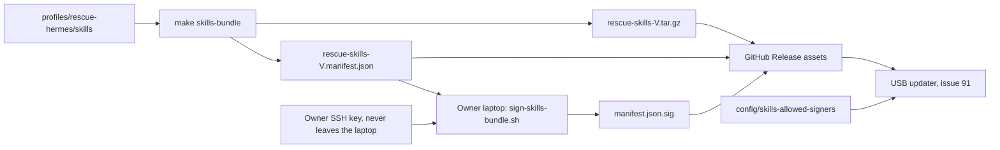
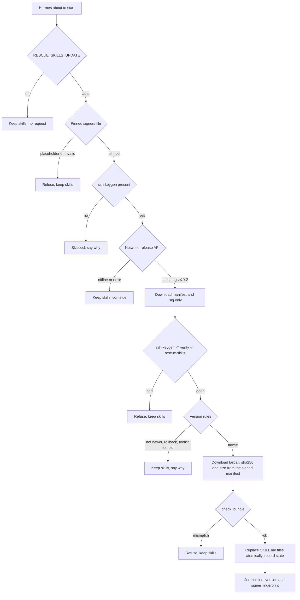

# Signed skills bundle: publishing and key custody

> Managed by **ahlikoding.com** and **satpamsiber.com** from **ahliweb.com**.

Ringkasan (ID): skill Hermes di USB yang sudah di lapangan hanya bisa diperbarui lewat bundel yang **ditandatangani manual oleh pemilik** dengan kunci SSH miliknya. CI hanya membangun dan memeriksa format bundel; CI tidak pernah menandatangani dan tidak pernah memegang kunci. USB memverifikasi tanda tangan terhadap `config/skills-allowed-signers` yang terpin. Selama berkas itu masih placeholder, tidak ada bundel yang dipercaya (fail closed). Sisi klien (pembaru saat Hermes start, `ahliweb/linux-mint-xfce-rescue-ai#91`) ada di bagian [Client side](#client-side-the-updater-91): otomatis (`auto`, bawaan), hanya mengganti teks skill, dan gagal-tertutup. Perintah, ID, dan path dipertahankan apa adanya.

Decision of the owner (2026-11-26): bundles are signed with the owner's own SSH key, manually, at release time (`ssh-keygen -Y sign`, namespace `rescue-skills`); the USB verifies with `ssh-keygen -Y verify` against a pinned `allowed_signers`; CI never signs.



The flow: CI builds only the unsigned pair; the owner signs the manifest locally; three assets go to the release; the USB checks them against the pinned public key.

## Status

| Part | Status |
|---|---|
| `make skills-bundle`, deterministic tarball and manifest, strict format check (`scripts/build-skills-bundle.py`, `scripts/lib/skills_bundle.py`) | Implemented |
| `scripts/sign-skills-bundle.sh` (owner only, refuses in CI) | Implemented; a real owner signature is an owner action |
| CI: build twice, byte-identical, format check; never signs (`.github/workflows/ci.yml`) | Implemented |
| `config/skills-allowed-signers` | Placeholder until the owner supplies the public key |
| Client updater `scripts/update-skills.py` (`scripts/lib/skills_update.py`): live launcher, Linux host launcher, Windows launcher | Implemented at source level against a local fake release server; a run against real GitHub with a real owner signature is Environment-blocked until the owner pins the key and releases |
| macOS host launcher | Not applicable: it does not open Hermes, so there is nothing to update |
| Pinned `config/skills-allowed-signers` copied to the USB bundle, the installed bundle, and the persistence image | Implemented |

## Format

Three release assets per bundle version `V` (`V` is the content of `VERSION`, and the release tag is `v<V>`):

| Asset | Content |
|---|---|
| `rescue-skills-<V>.tar.gz` | Only `skills/<name>/SKILL.md` regular files. No directories, symlinks, links, executables, or other paths. Sorted by path, ustar, `mtime` 0, `uid`/`gid` 0, empty owner names, mode `0644`, gzip with no name and `mtime` 0 |
| `rescue-skills-<V>.manifest.json` | Schema `rescue-skills-manifest/1`: `bundle_version`, `min_toolkit_version`, `tarball` (`name`, `sha256`, `size`), `files[]` (`path`, `sha256`, `size`, sorted). JSON with sorted keys, two-space indent, ASCII, trailing newline |
| `rescue-skills-<V>.manifest.json.sig` | `ssh-keygen -Y sign -n rescue-skills` over the manifest bytes |

Limits of format 1 (shared with the updater): at most 64 files, 128 KiB per file, 1 MiB in total, tarball at most 1 MiB, manifest at most 64 KiB; skill names match `^[a-z0-9][a-z0-9-]{0,62}$`; every `SKILL.md` is UTF-8 with front matter whose `name` equals its directory and a non-empty `description`. `bundle_version` is `VERSION` and increases with every release (anti-rollback key); `min_toolkit_version` comes from `config/skills-min-toolkit` and must not exceed `bundle_version`.

### What exactly is signed

**The manifest is signed, not the tarball.** The manifest holds the sha256 and size of the tarball and of every file, so one signature covers all bytes. Reasons: the updater can verify the signature and decide on version, anti-rollback, and minimum toolkit before it downloads the tarball; there is one canonical signed document instead of an unsigned manifest next to a signed tarball; and a different zlib on another machine cannot invalidate a signature, because the owner signs the manifest that names the exact tarball being uploaded. A changed byte in the manifest fails `ssh-keygen -Y verify`; a changed byte in the tarball fails the sha256 and size check against the signed manifest. Both are tested (`tests/test_skills_bundle.py`).

Determinism: the same commit gives byte-identical tarball and manifest on the same toolchain (checked twice in `make check` and in CI). Cross-machine byte equality is not required, and the owner must upload the exact tarball built beside the manifest they signed.

## Owner: create the signing key (once)

Use a dedicated key, not the key used to log in anywhere, with a passphrase. The values are never written to this repository; only the public half is.

```bash
ssh-keygen -t ed25519 -a 100 -C "rescue-skills-owner" -f ~/.ssh/rescue-skills-signing
```

Keep the private file `0600` on the owner's laptop only, back it up through the owner's own credential backup, and never paste it into an issue, chat, CI secret, or a coding agent. A hardware-backed key (`-t ed25519-sk`) is accepted by the format but is not tested here. Print the public half to put it in the repository:

```bash
cat ~/.ssh/rescue-skills-signing.pub
```

## Owner: pin the public key (pull request)

Replace `config/skills-allowed-signers` through a reviewed pull request: delete the placeholder marker line and add one line per trusted public key.

```text
<principal> namespaces="rescue-skills" ssh-ed25519 <PUBLIC-KEY-BASE64> <comment>
```

Rules the updater applies (the code is `allowed_signers_state` in `scripts/lib/skills_bundle.py`, and `python3 scripts/build-skills-bundle.py signers-status` prints the state):

| State | When | Updater |
|---|---|---|
| `placeholder` | The marker `RESCUE-SKILLS-ALLOWED-SIGNERS-PLACEHOLDER` appears anywhere, or no entry exists | Refuse, keep the bundled skills |
| `invalid` | An entry is not `<principal> namespaces="rescue-skills" <ssh-ed25519 or sk-ssh-ed25519@openssh.com key>`, or the key cannot be decoded | Refuse, same as placeholder |
| `pinned` | At least one entry, all well formed, no marker | May verify; the entry must restrict the namespace to `rescue-skills` |

Because the file is pinned on the USB when it is prepared, a USB only trusts the keys that were in the file at that time (see the rotation limits below). Security review of this pull request is required (`ownership-and-governance.md`).

## Owner: release procedure

The release itself needs the owner's authorization ([ownership-and-governance.md](ownership-and-governance.md)): technical gate, security gate, then authorization. Signing is the last step and always manual.

1. On the owner's laptop, check out the release commit (the tag `v<V>`) with a clean tree and run `make skills-bundle`. This writes `dist/rescue-skills-<V>.tar.gz` and `dist/rescue-skills-<V>.manifest.json`.
2. Sign. The script refuses when `CI` or `GITHUB_ACTIONS` is set, requires the key path explicitly, runs the format check first, passes the key to `ssh-keygen` by path only (it never reads, copies, or prints it), refuses to overwrite an existing `.sig`, and reads the signature back against the pinned `config/skills-allowed-signers` (or, while that file is still a placeholder, against your public key only, with a warning):

   ```bash
   scripts/sign-skills-bundle.sh --key ~/.ssh/rescue-skills-signing \
     --manifest dist/rescue-skills-<V>.manifest.json
   ```

3. The script prints the upload command and uploads nothing. Run it yourself after the release exists:

   ```bash
   gh release upload v<V> -R ahliweb/linux-mint-xfce-rescue-ai \
     dist/rescue-skills-<V>.tar.gz dist/rescue-skills-<V>.manifest.json dist/rescue-skills-<V>.manifest.json.sig
   ```

4. Check from a clean directory after downloading the three assets: `python3 scripts/build-skills-bundle.py check --manifest rescue-skills-<V>.manifest.json`, and `ssh-keygen -Y verify -f config/skills-allowed-signers -I <principal> -n rescue-skills -s rescue-skills-<V>.manifest.json.sig < rescue-skills-<V>.manifest.json`.

The bundle assets are not produced or signed by `.github/workflows/package.yml`; CI only checks the format on every push and pull request.

## Rotation and revocation

- **Rotation (planned key change):** create the new key, open a pull request that adds its line next to the old one, release a toolkit with the two-key file, refresh the USBs (re-run the USB preparation so the new pinned file is copied), then sign with the new key. Remove the old line in a later pull request once no USB depends on it.
- **Revocation (key lost or suspected):** remove the line in a pull request, sign nothing with the key again, and release. A USB in the field keeps trusting a removed key until it is refreshed, because the updater can change skill text only, never `config/skills-allowed-signers`, scripts, the catalog, or the policy. That limit is deliberate and is listed as a residual risk in [security-model.md](security-model.md). Tell operators to refresh affected USBs.
- Never reuse a `bundle_version`; a lost or revoked key does not change older signatures that already exist.

## Client side (the updater, #91)

Decision of the owner (2026-11-26): Hermes updates its skills **automatically when it starts**, default `auto`, verified with the owner's SSH signature against the `allowed_signers` pinned **on the USB**; fail closed; only skill text changes.



The flow: the updater decides everything it can before downloading the tarball, trusts only the pinned file, and installs only after every check passed.

### What it does, in order

1. **Switch.** `skills_update` is the setting `RESCUE_SKILLS_UPDATE` (environment, or `config/rescue.env` read as data): `auto` (default when unset) or `off`. `off` makes no network request at all. Any other value skips the update and says so.
2. **Pinned signers.** It reads `config/skills-allowed-signers` of the INSTALLED toolkit (the USB bundle `rescue-omes/`, `/usr/local/lib/rescue-omes`, or the persistence image) through `allowed_signers_state`; anything but `pinned` ends the run before any network use. There is no option to take a signers file from a download, and the launchers pass no trust override (a test pins that).
3. **`ssh-keygen`.** Without it the status is `skipped` with the reason (Windows 10/11 ships an optional OpenSSH client; the live image and Linux hosts have it).
4. **Release lookup.** `GET https://api.github.com/repos/ahliweb/linux-mint-xfce-rescue-ai/releases/latest` (the repository is pinned in code). Only `tag_name` (`vMAJOR.MINOR.PATCH`) is used; draft and prerelease are refused. Asset URLs are built from the pinned repository and the tag, never taken from the JSON.
5. **Manifest and signature first.** `rescue-skills-<V>.manifest.json` (at most 64 KiB) and `.sig` (at most 8 KiB). `ssh-keygen -Y verify -n rescue-skills` against the pinned file, for each principal in it; the fingerprint `ssh-keygen` reports must be one of the pinned keys of that principal. Only then is the manifest parsed (`parse_manifest`).
6. **Version rules.** `bundle_version` equals the release tag; `min_toolkit_version` is not above the installed `VERSION`; `bundle_version` is newer than the installed `VERSION` (the bundled skills of that toolkit already are that version); anti-rollback against the high-water mark recorded in `<HERMES_HOME>/skill-update/state.json`; the same version already active is `current`. When a launcher re-seeds the bundled text, the same signed version is installed again.
7. **Tarball last.** Its size is the signed `size` (the download is capped there), and it must match the signed sha256, then `check_bundle` (the same function the build uses): only `skills/<name>/SKILL.md` regular files, mode and owner, per-file sha256 and size, UTF-8 front matter whose `name` equals the directory. Nothing is extracted to disk.
8. **Install, atomically.** Only for names the toolkit already ships (`profiles/rescue-hermes/skills/<name>`; other names are skipped and counted, so a signed bundle cannot add a skill folder). Each `skills/<name>/SKILL.md` is staged beside its target and moved with `os.replace`; the previous bytes are kept for a rollback of the whole set if anything fails, and `state.json` is written last. Symlinks in the target path are refused. Other files in a skill folder, memories, sessions, scripts, the catalog, the policy and `config.yaml` are never touched. The toolkit's own `profiles/rescue-hermes/skills/` stays the fallback: the next seed or reinstall restores it.
9. **Record.** One line is appended to `<reports>/skill-update-journal.jsonl` (`0600` where the filesystem has modes) with closed fields only: time, status, reason code, toolkit version, installed version, bundle version, signer fingerprint, number of skills. No paths, names, or secrets. The operator message (Bahasa Indonesia) is printed and so lands in the launcher log.

### Statuses

| Status | Reason codes | Exit code | Skills |
|---|---|---|---|
| `updated` | `updated` | 0 | New text active |
| `current` | `current`, `not-newer` | 0 | Unchanged |
| `skipped` | `disabled`, `config-invalid`, `no-ssh-keygen`, `no-bundle`, `toolkit-too-old` | 0 | Unchanged |
| `offline` | `offline`, `http-error` | 0 | Unchanged |
| `refused` | `placeholder-signers`, `invalid-signers`, `bad-release`, `too-large`, `bad-signature`, `bad-manifest`, `version-mismatch`, `rollback`, `bad-bundle`, `state-invalid`, `toolkit-version-unreadable`, `unsafe-target` | 1 | Unchanged |
| `failed` | `install-error` | 1 | Restored |

The exit code is only a signal: every launcher ignores it, so Hermes always starts. The shipped `config/skills-allowed-signers` is still a placeholder, so until the owner pins a key every start prints the `placeholder-signers` refusal and changes nothing.

### Network safety

HTTPS only (plain HTTP only for loopback, which is what the tests use); certificate verification is the platform default and cannot be switched off; 10 s per request, 60 s for all requests together, and the launchers add a 90 s hard cap that also covers a DNS lookup that hangs; redirects only to `github.com` and `githubusercontent.com` hosts over HTTPS, at most five; no credential or token of any kind is sent; the response size is capped before and while reading. A proxy is taken only from `HTTPS_PROXY` and only when it is a plain `http(s)` URL (it is never logged, because it may hold credentials); anything else is ignored.

### Where it runs

| Launcher | When | Python | Pinned file read from |
|---|---|---|---|
| Live (`scripts/launch-hermes-rescue.sh`, also the persistence image) | After the preflight and the offline decision, before the scan; `--offline` when the network check already failed | system `python3 -I` | the installed bundle `config/` |
| Linux host (`host/rescue-linux.sh`) | In `start_hermes`, after `hermes-home` is seeded, before Hermes | the portable Python of the USB | `<usb>/rescue-omes/config/` |
| Windows (`host/rescue-windows.ps1`) | In `Invoke-HermesPhase`, after `hermes-home` is seeded, before Hermes | the portable `python.exe` of the USB | `<bundle>\config\` |
| macOS (`host/RESCUE-MACOS.command`) | Not applicable: it does not open Hermes | n/a | n/a |

On the host launchers the run report is written before Hermes starts, so the update result is in the launcher log and the journal, not in `report.md`. The live launcher updates before the scan and records it in the same journal. The run report schema and its three generators are unchanged on purpose (see [security-model.md](security-model.md)); a report line is a follow-up.

### Persistence migration

`scripts/migrate-persistence-state.py` takes the bundled `rescue-*` skills from the new image (new image wins), so an updated skill in an old image is replaced by the new toolkit's text. `<state>/hermes/skill-update/` is not migrated; the next start installs the newest signed bundle again.

### Operator notes

- To stop automatic updates on one USB, put `RESCUE_SKILLS_UPDATE='off'` in `config/rescue.env` (or set the variable).
- If the local record `skill-update/state.json` is damaged, the updater refuses (`state-invalid`); delete the folder `skill-update` in `HERMES_HOME` once you are sure, and the next start repairs it.
- Refresh the USB (re-run the preparation) after rotating or revoking the signing key, because the pinned file lives on the USB.

## Changelog

- Client updater (#91): `scripts/update-skills.py` and `scripts/lib/skills_update.py`, called by the live, Linux host and Windows launchers; `skills_update` switch (`RESCUE_SKILLS_UPDATE`, default `auto`); pinned signers copied to the USB bundle, the installed bundle, and the persistence image; statuses, network safety, and the placement table.
- Initial version: format 1, signing procedure, key custody, rotation and revocation, release steps.
